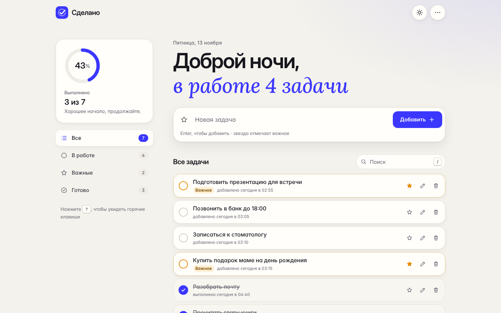
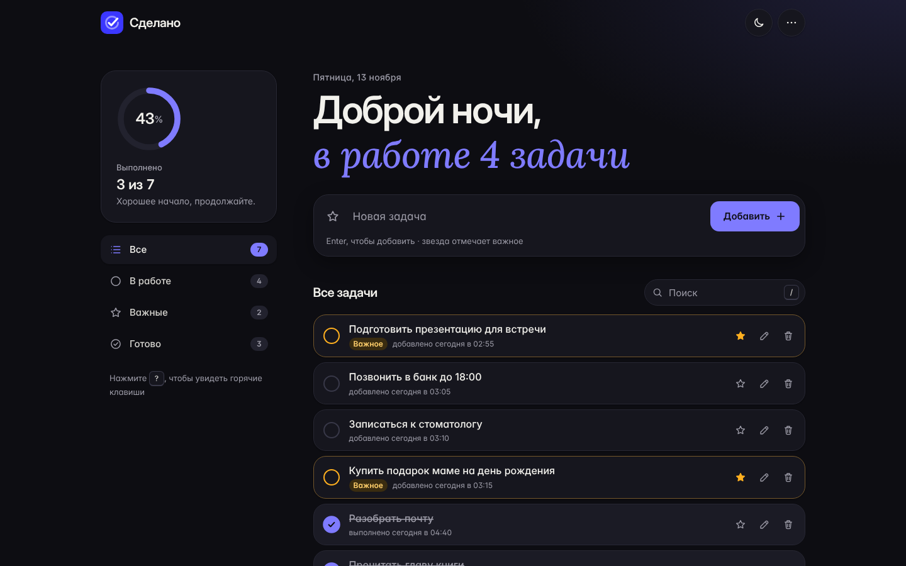
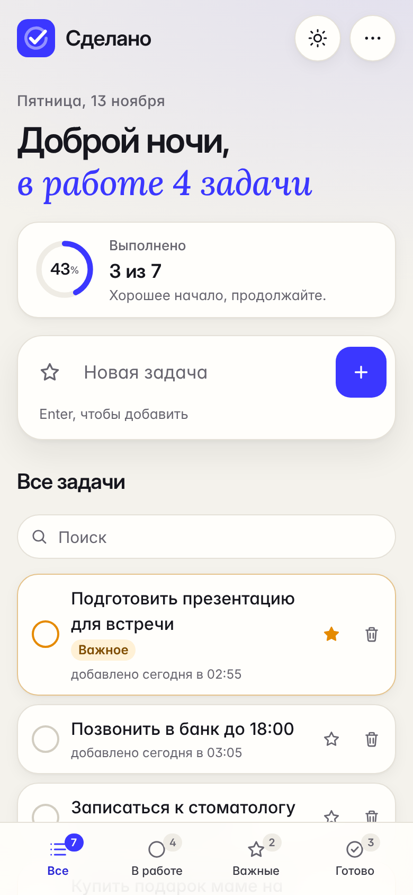

# Сделано · список задач

Быстрый и аккуратный To-Do List, который работает офлайн, ничего не отправляет на сервер и не требует регистрации.

**Сайт:** https://hvostdoc.online



| Тёмная тема | Телефон |
|---|---|
|  |  |

## Возможности

Требования задания:

1. **Добавление задач.** Через Enter или кнопку. Пустой и слишком длинный текст (больше 280 символов) не пройдёт, при этом появится понятная подсказка.
2. **Отметка выполненных.** Анимированная галочка и зачёркивание, кольцо прогресса. Выполненные задачи уходят вниз списка.
3. **Удаление.** Кнопкой, клавишей Delete или свайпом влево на телефоне. Любое удаление можно отменить кнопкой «Отменить» или сочетанием Ctrl+Z.
4. **Сохранение после перезагрузки.** Данные лежат в `localStorage` браузера, рядом хранится резервная копия.

Сверх задания:

- **важные задачи**: звезда при создании и у каждой задачи, отдельный фильтр;
- **поиск** с подсветкой совпадений, без учёта регистра и разницы «е/ё»;
- **фильтры** «Все / В работе / Важные / Готово» со счётчиками;
- **редактирование**: двойной клик (на телефоне одно касание), Enter сохраняет, Esc отменяет;
- **горячие клавиши**: `N`, `/`, `1`–`4`, стрелки, `S`, `E`, `Delete`, `Ctrl+Z`; полный список открывается по `?`;
- **три режима темы**: как в системе, светлая, тёмная;
- **синхронизация вкладок**: изменения в одной вкладке сразу видны в другой;
- **работа без интернета** и установка как приложения (PWA);
- **резервная копия в файл** и загрузка из файла с выбором «добавить» или «заменить»;
- приветствие по времени суток и живая подпись: сколько задач в работе.

### Для любых экранов и сценариев

- Раскладки: телефон (фильтры в нижней панели под большой палец), планшет, ноутбук (боковая панель), широкие мониторы, телефон горизонтально, экраны от 320 px.
- Учёт вырезов экрана (safe area), крупные цели касания на сенсорных экранах, поля ввода не вызывают автоувеличения на iPhone.
- Доступность: всё работает с клавиатуры, есть ARIA-разметка и объявления для экранных дикторов. Поддерживаются `prefers-reduced-motion`, `prefers-contrast`, `prefers-reduced-transparency`, режим высокой контрастности Windows и масштаб текста браузера (все размеры в `rem`).
- Отказоустойчивость: приватный режим и запрет хранилища, переполнение квоты, повреждённые данные (восстановление из копии), очень длинные слова и эмодзи, тысяча задач, отключённый JavaScript и старые браузеры (понятное сообщение), печать.

## Безопасность

Подробности в [SECURITY.md](SECURITY.md). Коротко:

- **XSS исключён на уровне браузера**: строгая Content Security Policy плюс **Trusted Types**, а текст выводится только через `textContent`;
- **сервер не трогает файловую систему во время работы**: файлы сайта загружаются в память по белому списку, поэтому обход путей невозможен;
- проверка заголовка `Host` (защита от DNS rebinding), доступ только от доверенного прокси, только `GET` и `HEAD`, лимиты на размер запроса, скрытая версия сервера;
- полный набор заголовков: CSP, HSTS, `frame-ancestors 'none'`, COOP/COEP/CORP, Permissions-Policy, `nosniff`, `no-referrer`;
- **одна зависимость** (`waitress`), закреплённая по SHA-256;
- автозапуск от учётной записи **LOCAL SERVICE** с минимальными правами;
- ни cookies, ни аналитики, ни внешних запросов: шрифты и иконки лежат в проекте.

## Установка

Подробная инструкция для Windows и Nginx Proxy Manager, включая DNS в REG.RU и решение проблем, лежит в **[INSTALL.md](INSTALL.md)**.

Коротко:

```
01_INSTALL.bat        установка (Python 3.10–3.14)
02_START.bat          запуск на http://127.0.0.1:47391
07_AUTOSTART_ON.bat   запуск вместе с Windows
09_PROXY_ACCESS.bat   доступ для Nginx Proxy Manager на другой машине (и только для него)
```

Затем в Nginx Proxy Manager добавьте Proxy Host `hvostdoc.online` с сертификатом Let's Encrypt. Если NPM на этом же Windows в Docker Desktop, укажите `host.docker.internal:47391`. Если на другой машине, укажите `<IP этого Windows>:47391` и запустите `09_PROXY_ACCESS.bat`.

На Linux и macOS:

```bash
python3 -m venv .venv && .venv/bin/pip install --require-hashes --no-deps -r requirements.txt
.venv/bin/python launcher.py start
```

## Тесты

```
06_RUN_TESTS.bat
```

или вручную:

```bash
python -m unittest discover -s tests -p "test_*.py"   # 29 тестов сервера и проверок безопасности
node --test tests/store.test.mjs                      # 35 тестов логики задач
node tests/e2e.mjs                                    # 25 сквозных проверок в настоящем Chrome
```

Сквозные тесты поднимают настоящий сервер и браузер. Они проверяют все пункты задания, перезагрузку страницы, XSS, Trusted Types, отмену действий, поиск, клавиатуру, свайп, синхронизацию вкладок, восстановление повреждённых данных, работу офлайн, пять размеров экрана и отсутствие ошибок в консоли. Всё это запускается в GitHub Actions на каждый push. Там же на Windows выполняются сами bat-файлы: установка, запуск, перезапуск, остановка.

## Устройство

```
public/                      сайт: HTML, CSS, JS, шрифты, иконки, service worker
  assets/js/store.js         ядро: данные, валидация, хранилище (без DOM, покрыто тестами)
  assets/js/app.js           интерфейс
server/                      сервер на waitress: раздача файлов и заголовки безопасности
launcher.py                  запуск, остановка, статус, проверка окружения
tools/                       служебные скрипты для bat-файлов и автозапуска
tests/                       тесты сервера, логики и сквозные тесты в Chrome
0X_*.bat                     управление на Windows
local_config.example.bat     образец настроек
```

Фронтенд написан на чистом HTML, CSS и JavaScript без фреймворков и сборки. Сервер работает на Python и waitress.

## Какие AI-инструменты использовались

Проект создан с помощью **Claude (Anthropic)** в агентном режиме:

- **дизайн**: собственная дизайн-система (тёплая «бумага», ультрамариновый акцент, Inter Display и курсив Lora), макеты для всех размеров экрана и проверка по скриншотам из автотестов;
- **код**: ядро с тестами, интерфейс, сервер, лаунчер, bat-скрипты и автозапуск;
- **безопасность**: CSP с Trusted Types, заголовки, проверка Host, минимальные права службы, закреплённые хеши зависимостей;
- **проверка**: автотесты в headless Chrome и на настоящем сервере, разбор найденных ими ошибок.

Постановка задачи, требования к развёртыванию и приёмка результата были за человеком.

## Лицензия

Код распространяется по лицензии [MIT](LICENSE). Шрифты Inter и Lora используются по лицензии SIL Open Font License 1.1 (см. `public/assets/fonts/`).
